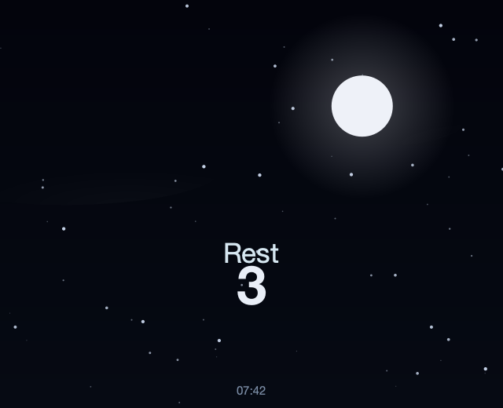
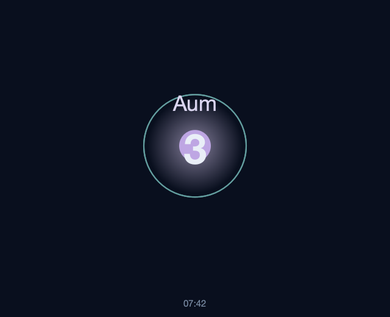
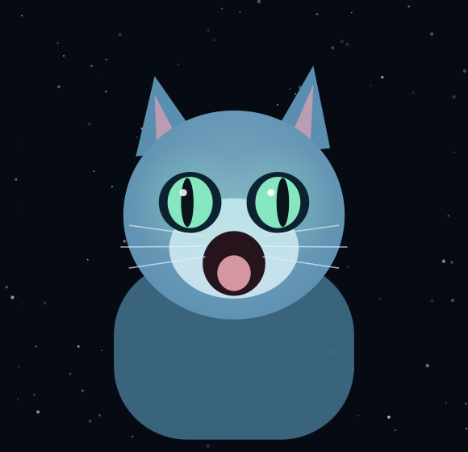

<h1 align="center">Vesper</h1>

<p align="center"><b>A breath-paced meditation &amp; sleep companion.</b><br>
A glowing avatar breathes with you, lip-syncs a procedural bedtime storyteller, and is
wrapped in fully procedural breath, voice, chant and nature sound — no audio assets
required.</p>

<p align="center">
  
</p>

Vesper paces your breath with a soft animated visualization and real-time synthesised
sound. It spans seven activities — **Meditate · Breathwork · Chant · Sing · Relax · Sleep ·
Read** — each with its own purpose-built control panel, visual scene and soundscape. At its
centre is a talking-head **avatar** (a 3D head, or one of **18 hand-drawn cartoon
characters**) that breathes, blinks, gazes around, emotes, and narrates a library of **269
soothing sleep-lectures** — or a whole **novel** — that gently follow the words on screen.
<!-- counts: 269 lectures / 56 branches · 150 voices · 66 phrases · 7 modes · 18 characters -->

It's a **self-contained** project: the entire audio / breath / voice / story engine is
vendored at [`breathsim/`](breathsim/) (no sibling dependency); the PySide6 front-end
lives in [`vesper/`](vesper/). Everything **degrades gracefully** — no GPU, no audio
device, no neural voices, no 3D head — there's always a calm fallback.

---

## Highlights

- **A living avatar** — the faceView ICT head rendered on the GPU (moderngl), with a soft
  software fallback. It nods with the breath, tilts and lifts its head on the neck,
  blinks, wanders its gaze, lip-syncs the
  narrator and shifts expression with the mood of the words. A **cyberpunk face-style**
  system (starry eyes, Tron/circuit grids that follow the head, translucent / dot-matrix
  renders) can react to the story, breath and chant. Or switch to the **2D cast**.
- **18 cartoon characters + costumes** — Cat, Penguin, Dog, Owl, Fox, Chicken, Bunny,
  Bear, Panda, Frog, Duckling, Hedgehog, **Mouse**, **Sheep**, **Robot**, Woman, Man and a
  talking **Skull** (hollow ember-lit sockets + a jaw that lip-syncs the narration, for spooky tales),
  each with breathing, blinks, tail-swishes, "hair-on-end" startles and drowsy
  **yawns / stretches / nod-offs / head-cocks / look-arounds**, **17 costumes**
  (incl. sleep-friendly Nightcap / Sleep Mask / Earmuffs), and its own narrator
  **voice + personality**. The bedtime storyteller can even pick a fitting character per
  scene (a cosy bear for a hibernation tale, a wise owl for the night sky).
- **Fully procedural sound** — **150 voices** synthesised in real time from noise, filters
  and a vocal-tract (formant) model: realistic breath timbres, human voice, vocal
  exercises, pranayama, singing, a playful **Cat** voice family, and nature **ambiences**
  (ocean, rain, forest, a crackling campfire, a struck singing bowl, wind chimes, night
  crickets, a distant night surf, a warm summer porch…) plus synthesised **bells & gongs, drums, winds & organs, environmental FX**
  and a **cosmic generative-music** engine sonifying real planetary + pulsar data. Nothing
  to download.
- **The bedtime storyteller** — **269 authored sleep-lectures across 56 branches** (the
  Cosmos, the Inner Planets &amp; the Dwarf Planets, Earth &amp; Sea, the Living World, the
  Human Body, Histories, Materials &amp; Making, Ideas &amp; Wonders, Myth &amp; Legend, the
  Polar Worlds, Weathers of the World, the Microscopic World, the Great Voyages, Grasslands
  of the World, Wetlands &amp; Marshes, the Night Garden, the Great Migrations, the Standing Stones, Great Canyons, Lullabies of the World, How the World Sleeps, Festivals of Light, Keepers of the Night, The Great Clocks, and many more), plus procedural bedtime stories,
  poetry nocturnes and a cognitive-shuffle sleep aid. Spoken by neural **Kokoro** TTS (or
  macOS `say`) — with the narration voices **grouped by language** (English, Spanish, French,
  Hindi, Italian, Japanese, Portuguese, Chinese) so you can pick a narrator in yours —
  slowing and quietening as you drift off, and the **soundscape, the backdrop and the
  character all gently follow the words**.
- **Read a novel** — a dedicated **Read** mode and a book Reader narrate full public-domain
  books (download from Project Gutenberg / Standard Ebooks, or drop in your own .txt/.epub) —
  cleaned to read **the story, not the boilerplate** (the title page, table of contents and
  illustration captions are skipped) — with **read-along text** that highlights and
  auto-scrolls, **Night / Sepia / Day** reading
  themes, a searchable **jump-to-chapter** picker, adjustable pace, an opt-in
  **sleep fade** that quietens the narration and stops after a set time, and
  resume-where-you-fell-asleep. A book can also be a **bedtime
  read** in Sleep, fading out with the sleep timer — and an optional **dramatized cast** can
  voice each character with its own narrator, face and mood. A **Find & manage books** window
  shows each result's popularity and estimated length, **says exactly why** a download failed
  (no internet · not found · timed out · server busy…), **verifies a book arrives whole**
  (no more silently-shortened downloads), and lets you rename, re-download and delete books
  with a running "N books · ~X h · Y MB" library summary.
- **Realistic chanting** — **66 mantras, chants &amp; songs** (Om Mani Padme Hum, Aum,
  Om Tare Tuttare, Nam Myoho Renge Kyo, Gregorian plainchant, vocalises, affirmations)
  sung as articulated syllables with real consonants, over a tonic drone with a reciting
  tone and an on-screen sing-along.
- **A sense of space** — an optional master **reverb** (room → hall → cathedral) that
  makes chant and song sound like they're in a real room.
- **Evidence-based calm** — resonance breathing near **~6 breaths/min**, longer exhales,
  **4-7-8 / box / physiological-sigh** patterns; guided **Body-Scan &amp; PMR**, **NSDR /
  Yoga Nidra**, **Autogenic Training** (heaviness · warmth · calm),
  **Loving-Kindness (Metta)** (good wishes in widening circles), **guided imagery**
  (a "safe and peaceful place" you build and rest inside, sense by sense), a one-tap
  **Physiological-Sigh reset**; a warm, low-blue **Sleep
  wind-down** that dims the screen on a melatonin-friendly curve; pink / brown noise; and
  gentle, opt-in bedtime notes — a **gratitude** "one good thing" and a **park-your-worries**
  tomorrow's-list, both shown to shorten sleep onset.
- **Accessible &amp; tidy** — global **UI text-size**, a **calm-visuals (reduce-motion)**
  toggle (also softens + spaces out the characters' drowsy gestures), a **mono-audio**
  downmix for single-sided hearing, **narration captions**
  (the spoken line shown on-screen for deaf / hard-of-hearing listeners), an
  **always-warm low-blue screen** for evening eye comfort, drag-and-drop file loading,
  and a **searchable chooser** for the long lists (200+ stories, 150 voices).
- **Per-mode visual scenes** — a breathing **orb** (motes, exhale rings, a coherence halo
  near 6 bpm), a starry **night**, a moonlit **sea**, tone-reactive **ripples**, warm
  rising **lanterns** and a hushed **snowfall** (low-blue sleep beds), an on-screen
  **pitch trainer**, and themed
  animated **backdrops** (stars, embers, rain, forest, a quiet city…) that crossfade to
  match the story.
- **Real tools** — pitch trainer, mindfulness bell, breath-hold (retention) timer, mala /
  japa counter, an **hourglass session timer** you flip to reset, a full **Voice Editor**
  (live wave + spectrum), **Pattern Editor**, **Presets Manager**, a layer **Mixer**,
  **11 guided programs**, multi-night **courses**, practice **Stats** (streaks, calendar,
  insights), and offline **WAV export**.

## Modes

| Mode | What it's for | Scene |
|------|---------------|-------|
| **Meditate** | Paced / resonance breathing + a mindfulness bell | Orb |
| **Breathwork** | Pranayama techniques, guided rounds, retention timer | Orb |
| **Chant** | Mantras, a reciting tone over a tonic drone, japa counter | Ripple |
| **Sing** | Warm-ups + an on-screen pitch trainer (target vs. your voice) | Pitch trainer |
| **Relax** | A multi-layer nature soundscape mixer | Wave |
| **Sleep** | The bedtime storyteller + wind-down + screen dimming | Night |
| **Read** | Narrate a novel with read-along text (Night / Sepia / Day) | Drift |

The **mode bar** is the primary navigation; a resizable side panel rebuilds into each
mode's purpose-built tools, and a tidy menu bar (File · Modes · Sessions · Books · Pattern ·
Voice · Sound · Face · View · Help) is the global escape hatch for everything else.

## Gallery

<p align="center">
  
</p>

<table>
  <tr>
    <td align="center"><br><sub><b>Orb</b> — Meditate / Breathwork</sub></td>
    <td align="center"><br><sub><b>Night</b> — Sleep</sub></td>
  </tr>
  <tr>
    <td align="center"><br><sub><b>Wave</b> — Relax</sub></td>
    <td align="center"><br><sub><b>Ripple</b> — Chant / Sing</sub></td>
  </tr>
</table>

## Run

```bash
pip install -r requirements.txt      # + see the faceView note below
python run.py                        # launch the app
python selftest.py                   # headless checks (no display/audio needed)
```

`VESPER_FACE=cat python run.py` starts on the 2D character face (also under **Face ▸
Cartoon character face**).

## Dependencies

Pure pip packages (see [`requirements.txt`](requirements.txt)): **PySide6**, **numpy**,
**moderngl**, **sounddevice**, **soundfile**, **scipy**.

Optional extras (each degrades gracefully if absent):

- **faceView** — the 3D head renderer, installed editable from its own project (~1.2 GB,
  so *not* vendored). Without it, the face falls back to the hand-drawn **2D character**
  cast that breathes, blinks and lip-syncs the story.
- **kokoro-onnx** — neural narration voices (`pip install kokoro-onnx` +
  `python -m breathsim.kokoro_tts --download`). Without it, narration uses macOS `say`.
- **XTTS-v2** — *highest-fidelity* offline voices (voice-clone + 58 studio speakers,
  faster-than-real-time on Apple Silicon). Opt-in and **not bundled** (it's large and
  under the non-commercial Coqui CPML): install it yourself with
  `python tools/setup_xtts.py --accept-license`, then pick an "XTTS" narration voice in
  Sleep. The 15 characters speak in XTTS too when it's installed. See
  [`docs/XTTS.md`](docs/XTTS.md).

> Graceful degradation: no GPU → software face; no faceView → the cartoon cast; no audio
> device → visual only; no Kokoro → `say`; no XTTS → Kokoro / `say`.

<p align="center">
  
  <br><sub>The cartoon cast — for when faceView isn't installed (or just for fun).</sub>
</p>

## Project layout

- [`vesper/`](vesper/) — the Qt app: window, resizable workspace-driven control panel, the
  3D face + 2D character cast, the visual scenes, the menu bar, dialogs (Voice / Pattern /
  Preset editors, Mixer, Stats, Story Library). See [`INTERFACE.md`](INTERFACE.md) for the
  full module map.
- [`breathsim/`](breathsim/) — the **vendored core**: audio engine, breath controller,
  voices, patterns, modes, narration (Kokoro / `say` / XTTS), reverb, `phrases.py` +
  `vocal.py` (chant synthesis), `stories.py` + the whole **lecture library**
  (`lectures*.py`), the **novels stack** (`books.py` / `bookreader.py` / `booksource.py` /
  `bookcast.py`), `sound_cues.py` (text-matched ambience), `textures.py` /
  `cosmic.py` (procedural sound) and `story_db.py`.
- [`tools/`](tools/) — the opt-in `setup_xtts.py` installer, the voice loudness audit.
- `data/stories.db` — a SQLite record of every story (rebuilt on startup, or
  `python -m breathsim.story_db`). Browse it in-app via **Help ▸ Story Library**.

## How it works

A single `BreathController` is the clock. ~40 times a second the GUI reads the current
breath state and drives either the **face** (head nod + breathing zoom; narration
amplitude → jaw) or the active **scene**, while the audio engine renders click-free stereo
blocks on a separate thread — layering a morphable breath voice, an ambience bed, optional
effects, a chant/song voice and chimes, through an optional reverb space — all paced by the
same breath. The control panel mirrors live state every frame, so the menus, a guided
program and a character swap all stay in sync. Add a voice, a breath pattern, a persona, an
ambience, a guided program, a chant or a sleep-lecture by dropping in one small file; no
engine changes needed.

## License

See [`LICENSE`](LICENSE). The avatar is rendered from the
[ICT-FaceKit](https://github.com/ICT-VGL/ICT-FaceKit). Optional XTTS-v2 voices are under
the non-commercial Coqui Public Model License and are never bundled.
