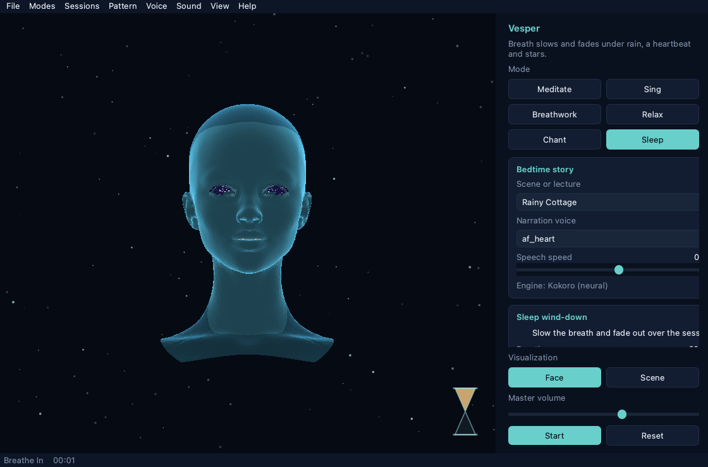
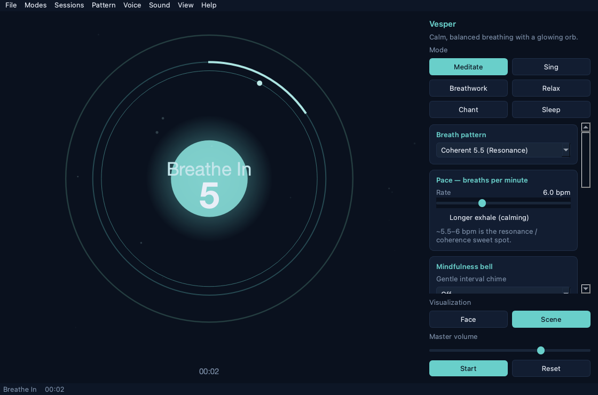
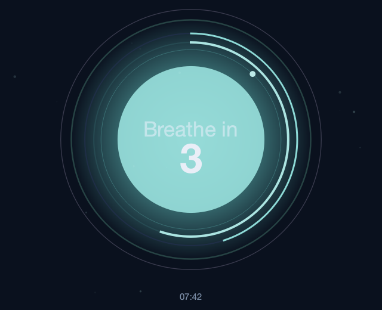
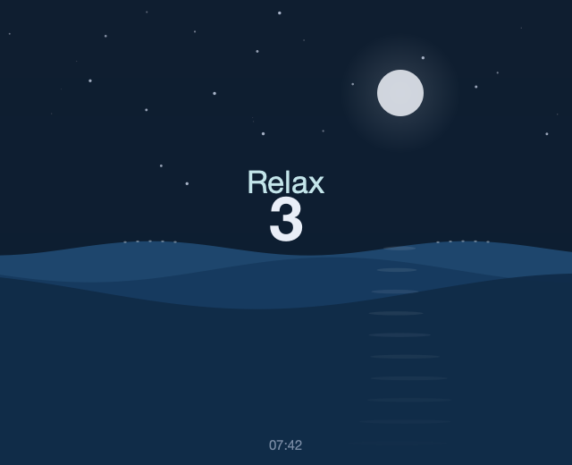

<h1 align="center">Vesper</h1>

<p align="center"><b>A breath-paced meditation &amp; sleep companion.</b><br>
A glowing 3D avatar breathes with you, lip-syncs a procedural bedtime storyteller,
and is wrapped in fully procedural breath, voice, chant and nature sound — no audio
assets required.</p>

<p align="center">
  
</p>

Vesper paces your breath with a soft animated visualization and real-time synthesised
sound. It spans six activities — **Meditate, Breathwork, Chant, Sing, Relax, Sleep** —
each with its own purpose-built control panel, visual scene and soundscape. At its
centre is a 3D talking-head **avatar** that breathes, blinks, gazes around, emotes, and
narrates a library of **65 soothing sleep-lectures**.

It's a **self-contained** project: the entire audio / breath / voice / story engine is
vendored at [`breathsim/`](breathsim/) (no sibling dependency); the PySide6 front-end
lives in [`vesper/`](vesper/).

---

## Highlights

- **A living 3D avatar** — the faceView ICT head, rendered on the GPU (moderngl) with a
  soft software fallback. It nods with the breath, blinks and wanders its gaze, lip-syncs
  the narrator, and shifts expression with the mood of the words.
- **Fully procedural sound** — 90 voices synthesised in real time from noise, filters and
  a vocal-tract (formant) model: realistic breath timbres, human voice, vocal exercises,
  pranayama, singing, and nature **ambiences** (ocean, rain, forest, a crackling campfire,
  a struck singing bowl, wind chimes, night crickets, a cat's purr…), plus a playful
  **Cat** voice family — cat breath, a contented sigh, a soft meow on each out-breath,
  and a purr. Nothing to download.
- **The bedtime storyteller** — **65 authored sleep-lectures** across 8 branches (the
  Cosmos · Earth &amp; Sea · the Living World · the Human Body · Histories · Materials &amp;
  Making · Ideas &amp; Wonders · Myth &amp; Legend), spoken by neural **Kokoro** TTS (or macOS
  `say`), slowing and quietening as you drift off, with the ambience gently **following
  the words**.
- **Evidence-based calm** — resonance breathing near **~6 breaths/min**, longer exhales,
  **4-7-8 / box / physiological-sigh** patterns; a warm, low-blue **Sleep wind-down** that
  dims the screen on a melatonin-friendly curve; pink / brown noise for masking.
- **Per-mode visual scenes** — a breathing **orb** (drifting motes, exhale rings, a
  coherence halo near 6 bpm), a starry **night** (clouds + a rare shooting star), a
  moonlit **sea**, tone-reactive **ripples**, and an on-screen **pitch trainer**.
- **Real tools** — pitch trainer, mindfulness bell, breath-hold (retention) timer, mala /
  japa counter, an **hourglass session timer** you flip to reset, a full **Voice Editor**
  (with live wave + spectrum), **Pattern Editor**, **Presets Manager**, a layer **Mixer**,
  guided **programs**, and offline **WAV export**.

## Modes

| Mode | What it's for | Scene |
|------|---------------|-------|
| **Meditate** | Paced / resonance breathing + a mindfulness bell | Orb |
| **Breathwork** | Pranayama techniques, guided rounds, retention timer | Orb |
| **Chant** | Mantras, a reciting tone over a tonic drone, japa counter | Ripple |
| **Sing** | Warm-ups + an on-screen pitch trainer (target vs. your voice) | Pitch trainer |
| **Relax** | A multi-layer nature soundscape mixer | Wave |
| **Sleep** | The bedtime storyteller + wind-down + screen dimming | Night |

## Gallery

<p align="center">
  
</p>

<table>
  <tr>
    <td align="center"><br><sub><b>Orb</b> — Meditate / Breathwork</sub></td>
    <td align="center"><br><sub><b>Night</b> — Sleep</sub></td>
  </tr>
  <tr>
    <td align="center"><br><sub><b>Wave</b> — Relax</sub></td>
    <td align="center"><br><sub><b>Ripple</b> — Chant / Sing</sub></td>
  </tr>
</table>

## Run

```bash
pip install -r requirements.txt      # + see the faceView note below
python run.py                        # launch the app
python selftest.py                   # headless checks (no display/audio needed)
```

## Dependencies

Pure pip packages (see [`requirements.txt`](requirements.txt)): **PySide6**, **numpy**,
**moderngl**, **sounddevice**, **soundfile**, **scipy**.

Two optional extras:
- **faceView** — the 3D head renderer for the avatar, installed editable from its own
  project (it is large, ~1.2 GB, so it is *not* vendored here). Without it, the face
  falls back to a hand-drawn **2D cartoon cat** that breathes, blinks and lip-syncs the
  story. You can also choose the cat anytime in **View ▸ Cartoon cat face** (or start on
  it with `VESPER_FACE=cat`).
- **kokoro-onnx** — neural narration voices (`pip install kokoro-onnx` +
  `python -m breathsim.kokoro_tts --download`). Without it, narration uses macOS `say`.

Everything **degrades gracefully**: no GPU → software face; no audio device → visual
only; no Kokoro → `say`; no faceView → the cartoon-cat face.

<p align="center">
  
  <br><sub>The cartoon-cat fallback — for when faceView isn't installed.</sub>
</p>

## Project layout

- [`vesper/`](vesper/) — the Qt app: window, workspace-driven control panel, the 3D face,
  the visual scenes, menus, dialogs (Voice / Pattern / Preset editors, Mixer, Stats, Story
  Library). See [`INTERFACE.md`](INTERFACE.md) for the full module map.
- [`breathsim/`](breathsim/) — the **vendored core**: audio engine, breath controller,
  voices, patterns, modes, narration, `stories.py` + the whole **lecture library**
  (`lectures*.py`), `sound_cues.py` (text-matched ambience), `textures.py` (procedural
  ambiences) and `story_db.py`.
- `data/stories.db` — a SQLite record of every story (rebuilt on startup; or
  `python -m breathsim.story_db`). Browse it in-app via **Help ▸ Story Library**.

## How it works

A single `BreathController` is the clock. ~40 times a second the GUI reads the current
breath state and drives either the **face** (head nod + breathing zoom; narration
amplitude → jaw) or the active **scene**, while the audio engine renders click-free
stereo blocks on a separate thread — layering a morphable breath voice, an ambience bed,
optional effects and chimes — all paced by the same breath. Add a voice, a breath pattern,
a persona, an ambience, a guided program or a sleep-lecture by dropping in one small file;
no engine changes needed.

## License

[MIT](LICENSE) © 2026 George Dickinson.
