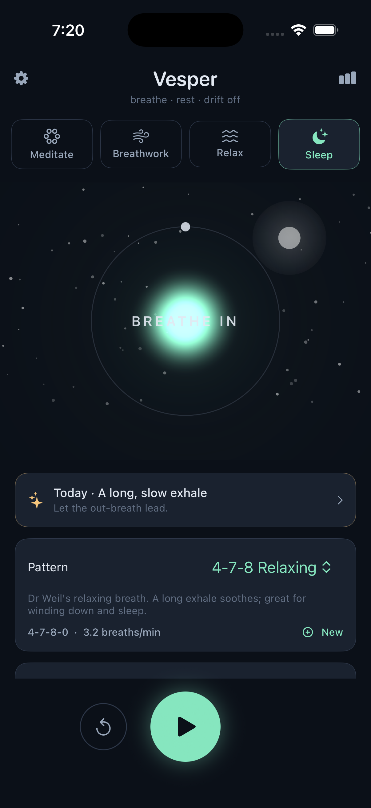
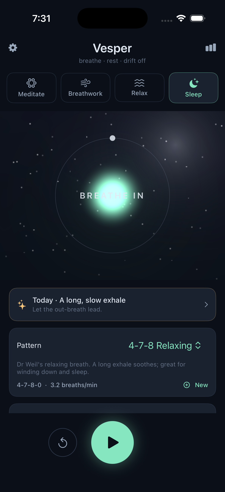
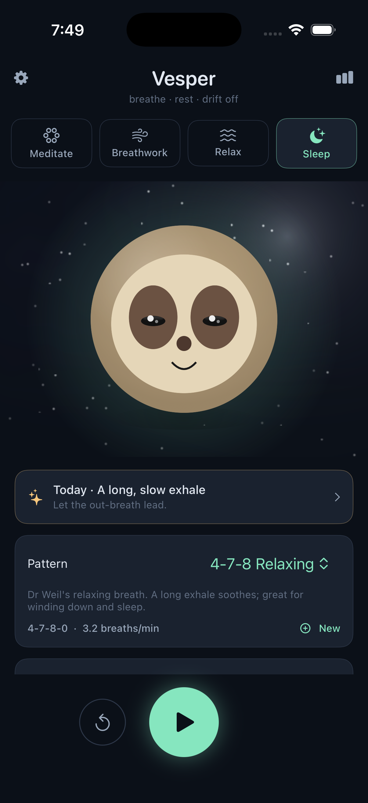
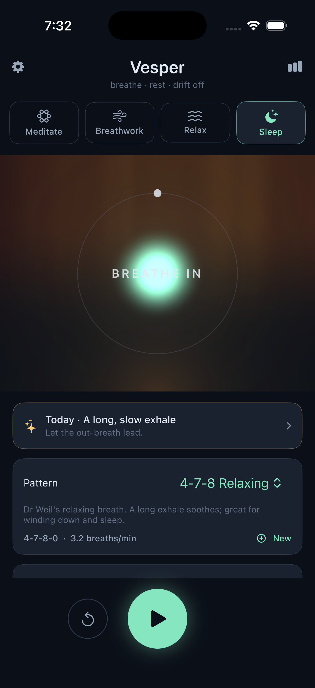
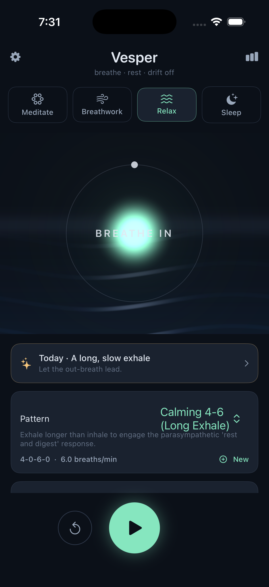
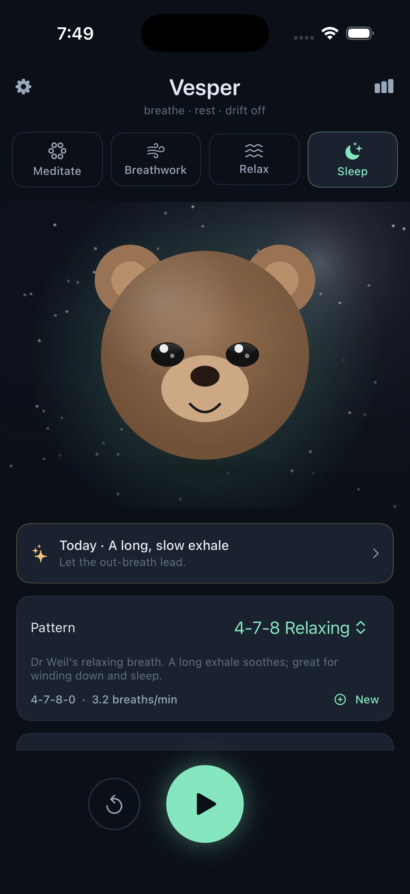

# Vesper for iOS (native Swift)

A native **SwiftUI + AVAudioEngine** build of Vesper for iPhone and iPad — the
companion to the desktop (PySide6) app. It is a fresh native implementation, not
a wrapper: the breath timing, procedural breath audio, and the breathing orb are
re-built in Swift so the app runs fully on-device, offline, and — crucially for a
sleep app — **keeps playing with the screen locked** (the `audio` background mode).

**Safety:** Vesper is for relaxation only. It is not a medical device and not medical advice. Breathe gently and comfortably. Stop and breathe normally if you feel dizzy, light-headed or uncomfortable. If you have a health condition, talk to a doctor or other qualified professional before trying breathing exercises. Patterns with breath holds or fast, forceful breathing are not suitable during pregnancy or for people with heart or respiratory (breathing) conditions. Never use Vesper while driving, operating machinery, or anywhere it is unsafe to become drowsy.

## Screenshots

| Metal breathing orb | Night-sky scene | Sleepy companion |
|---|---|---|
|  |  |  |
| **Fireplace scene** | **Ocean (Relax)** | **Bear companion** |
|  |  |  |

## Highlights (2026 update)

- **GPU visuals (Metal).** A fluid, self-lit **breathing-orb shader** plus five
  scene shaders (night sky · aurora · embers · fireplace · ocean) with gentle
  **CoreMotion tilt parallax** and Reduce-Motion support. *(One-time setup: Xcode 26
  ships the Metal compiler separately — run `xcodebuild -downloadComponent MetalToolchain`.)*
- **Dimensional companions.** Shared-kit soft shading, glossy catch-lit eyes,
  contact shadows and an idle head-tilt; in Sleep they get **drowsy** (drooping
  eyes, a contented smile, drifting "z"s) as the wind-down deepens.
- **On-device AI bedtime stories.** Apple **Foundation Models** (iOS 26, fully
  `#available`-guarded) compose a fresh, calming story — narrated by Kokoro —
  falling back to a written lecture when Apple Intelligence isn't present.
- **Generative ambient pad** ("Dreamfield"): a slow evolving chord, click-free.
- **Heart coherence ring (Meditate).** A breathing-band **coherence score + ring** and an
  adaptive paced-breathing rate, from Apple Health HR (guarded) or a breath-driven demo. A
  relaxation display, not a medical measurement.
- **Sleep sessions.** Four guided sessions drawn from CBT-I and sleep-hypnosis techniques
  (paradoxical intention · a "sleep deeper" suggestion · stimulus control · constructive
  worry), a **Pink Noise Swell** bed, and a self-guided **CBT-I-style program** (not
  medical treatment): a sleep diary, a sleep-efficiency
  -driven **sleep window** with a wake-time anchor, **wind-down reminders**, and a
  **sleep-regularity** score. (See [`Vesper/docs/HEALTHKIT_SETUP.md`](Vesper/docs/HEALTHKIT_SETUP.md).)
- **Apple platform**: App Intents/Siri quick-start, daily reminders, streaks +
  calendar heatmap, HealthKit **Mindful Minutes / State of Mind** write-back, a
  custom-pattern builder, and a **Read-aloud** mode.
- **Neural voices**: bundled **fp32 Kokoro** (highest-quality, fully offline,
  ~50 voices) — the same quality tier as the desktop.

## What works

- **Four modes** (Meditate · Breathwork · Relax · Sleep) — the mode bar is the
  primary navigation, as on desktop. Each one-tap configures pattern + breath
  voice + ambience.
- **Breath pacing**: 16 patterns (Coherent 5.5, Box, 4-7-8, Physiological Sigh, …)
  with the exact desktop envelope math (raised-cosine `volume`, sine-bump `airflow`).
- **Procedural breath sound**: a real-time `AVAudioSourceNode` renders filtered
  noise (white/pink/brown → swept band-pass → brightness low-pass) shaped by the
  breath airflow — loud mid-breath, silent during holds. Five breath voices.
- **Nature ambiences**: a parametric `AmbienceSynth` (rain · ocean surf · soft
  wind · crackling fire · stream · night crickets · pink/brown noise) mixed as a
  continuous second layer, with its own level.
- **Breathing orb**: a SwiftUI `Canvas` scene with layered glow, a guide ring, a
  travelling cycle dot, a session-progress arc, and a phase-tinted hue.
- **36 cartoon characters** drawn with SwiftUI `Canvas` (the full desktop cast:
  Cat, Penguin, Dog, Owl, Fox, Chicken, Bunny, Bear, Panda, Frog, Duckling,
  Hedgehog, Mouse, Rat, Sheep, Sloth, Koala, Red Panda, Lion, Tiger, Elephant,
  Giraffe, Rhino, Pig, Cow, Monkey, Deer, Snowman, Luna, Robot, Bot, Alien,
  Martian, Woman, Man, Skull) — the Sleep mode shows one as a breathing
  **companion** that lip-syncs the narration.
- **337 sleep-lectures** across 73 branches (bundled `lectures.json`), a
  branch → lecture grouped picker and a **Surprise me** random pick; narrated by
  `AVSpeechSynthesizer` (premium/enhanced voice) with on-screen captions —
  continuing with the screen off.
- **Narration voices** — a Voice picker over every installed system voice
  (Default / Enhanced / **Premium**) plus your **Personal Voice** (iOS 17+), with a
  Preview button; and an opt-in **Kokoro neural** path (download the ~110 MB model
  in-app; the inference engine drops in per [`docs/KOKORO_IOS.md`](docs/KOKORO_IOS.md)
  for desktop-grade offline voices).
- **Background audio**: `.playback` session + `UIBackgroundModes = audio`, with
  **lock-screen Now Playing** controls (`MPNowPlayingInfoCenter` / remote commands).
- **Practice Stats**: sits · total minutes · day streak + recent sessions.
- **App icon** + **persistence** of every selection via `UserDefaults`.

## Architecture (mirrors the desktop core)

```
VesperApp ─ RootView ─ SessionViewModel ─┬─ BreathClock   (the single timing authority)
                                         ├─ AudioEngine   (AVAudioSourceNode → BreathSynth → DSP)
                                         └─ Narrator      (AVSpeechSynthesizer)
        OrbView (Canvas)  reads the same BreathClock state each frame.
```

| File | Role |
|---|---|
| `Core/BreathPattern.swift` | pattern model + `BreathMath.state(at:)` envelope (port of `patterns.py`) |
| `Core/Patterns.swift` | the preset library |
| `Core/BreathClock.swift` | pausable monotonic clock; read lock-free from the audio thread |
| `Audio/DSP.swift` | white/pink/brown noise, RBJ biquad, one-pole, soft-clip (port of `dsp.py`) |
| `Audio/BreathVoice.swift` / `BreathSynth.swift` | breath-voice params + the real-time renderer |
| `Audio/AudioEngine.swift` | `AVAudioEngine` host, session, background audio |
| `Audio/Narrator.swift` | spoken narration + captions |
| `Content/Lectures.swift` | starter sleep-lectures (the full 337 ship later as JSON) |
| `Scenes/OrbView.swift` | the breathing orb (`Canvas`) |
| `UI/Theme.swift` / `RootView.swift` / `SessionViewModel.swift` | palette, screen, state hub |

Every file is kept under 500 lines; one concept per file.

## Build & run

Open `Vesper.xcodeproj` in **Xcode** (26.x), pick an iPhone/iPad simulator or a
device, and press **Run**. Bundle id `com.georgedickinson.vesper`; deployment
target iOS 17; no third-party dependencies.

### Run on your own iPhone/iPad (free Personal Team)

The project is configured for automatic signing with team `L42G2H67V8`. To put it
on a real device:

1. Plug the device into the Mac (trust the computer when prompted).
2. Open `Vesper.xcodeproj`; in the toolbar's device menu pick your device.
3. Target ▸ **Signing & Capabilities**: confirm "Automatically manage signing"
   and your team are selected (Xcode creates a development profile on the fly).
4. Press **Run**. On the device, trust the developer profile under
   Settings ▸ General ▸ VPN & Device Management.

A free Personal Team build **expires after ~7 days** — just Run again to renew.
**TestFlight / App Store** distribution instead needs a paid Apple Developer
Program membership (which adds an Apple Distribution cert + App Store Connect).
When that's in place, set `INFOPLIST_KEY_ITSAppUsesNonExemptEncryption` (already
present), archive in Release, and upload via Xcode Organizer or an ASC API key.

### Verification status

The app **builds clean** (`** BUILD SUCCEEDED **`, 0 errors / 0 warnings) and runs
in the iOS Simulator. Headless build/run:

```
xcodebuild -project Vesper.xcodeproj -scheme Vesper \
  -destination 'platform=iOS Simulator,name=iPhone 17 Pro' build CODE_SIGNING_ALLOWED=NO
```

If `xcodebuild` ever fails to load `IDESimulatorFoundation` (stale shared Xcode
components), repair once with `sudo xcodebuild -runFirstLaunch`. The Xcode GUI build
is unaffected. Note: `swiftc -typecheck` is a fast inner-loop check but does **not**
run definite-initialization — use a full build to catch those.

## Roadmap toward parity

- Bundle the full lecture library + books (JSON) and a book reader.
- The 36 cartoon characters (port the `char_*` `QPainter` drawings to SwiftUI `Canvas`).
- Nature ambience beds, chant/sing modes, the pitch trainer, Stats/streaks.
- A neural on-device TTS option; a Now-Playing lock-screen control.
